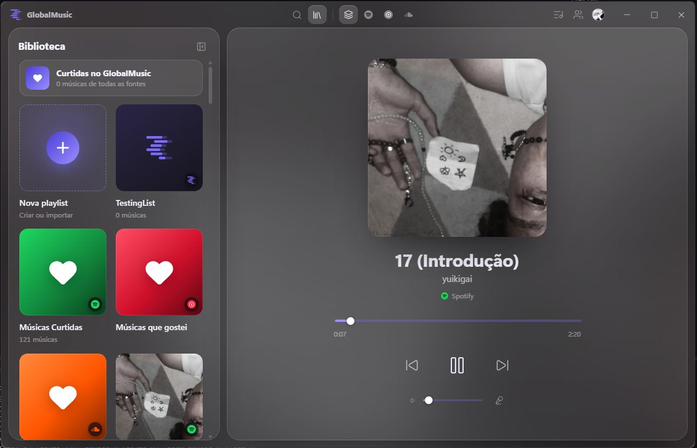
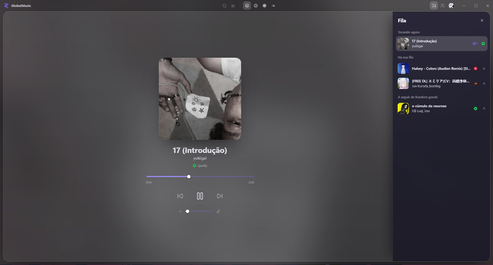
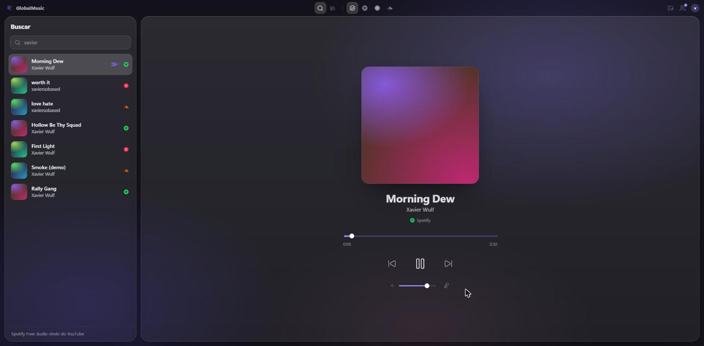

<div align="center">


# GlobalMusic

**Spotify, YouTube Music e SoundCloud num app só, consumindo menos de 80 MB de RAM.**

A busca procura nas três fontes ao mesmo tempo, a biblioteca junta as playlists de todas as
suas contas e as suas playlists do GlobalMusic misturam faixas de qualquer lugar. Funciona até sem conta.

<a href="https://globalmusic.216saint.com.br/GlobalMusic_0.6.2_x64-setup.exe"></a>




</div>

<table>
  <tr>
    <td></td>
    <td></td>
  </tr>
  <tr>
    <td align="center"><sub>Só o player, com a fila no menu lateral</sub></td>
    <td align="center"><sub>Busca nas três fontes ao mesmo tempo</sub></td>
  </tr>
</table>

## 🌃 Recursos

- 🔎 **Busca federada**: Spotify, YouTube Music e SoundCloud de uma vez, com resultados intercalados.
- 📚 **Biblioteca unificada**: as playlists de todas as contas, com o selo da fonte no canto de cada capa.
- ➕ **Playlists do GlobalMusic**: crie playlists com músicas de qualquer fonte, com foto própria e sugestões do que você ouviu por último.
- 🔗 **Importe e compartilhe**: cole o link de uma playlist do Spotify, YouTube Music ou SoundCloud para ela entrar na biblioteca. As suas playlists do GlobalMusic viram um link para mandar a quem quiser.
- 🙌 **Funciona sem conta**: busca no YouTube Music e no SoundCloud, playlists do GlobalMusic, curtidas e playlists públicas importadas por link.
- 🎶 **Fila multiplataforma**, como a do Spotify: o que você adiciona toca antes do resto da playlist, e ela abre num menu lateral.
- 🆓 **Spotify Free toca**: a mesma gravação é encontrada no YouTube e tocada de lá.
- 🔁 **Escolha a versão**: se a música do Spotify cair numa versão errada do YouTube (ao vivo, cover), você troca e o app lembra.
- 🎤 **Letras sincronizadas** pelo [LRCLIB](https://lrclib.net): o verso do momento fica destacado e clicar num verso pula até ele.
- ⏭️ **Pula trechos sem música** dos clipes do YouTube (introduções faladas, cenas depois da música), marcados pela comunidade do [SponsorBlock](https://sponsor.ajay.app). A consulta é anônima.
- ⚡ **Começa rápido**: as faixas em tela são preparadas antes do clique, as duas próximas da fila já ficam baixadas e as que você já ouviu tocam do cache em disco.
- ⌨️ **Teclas de mídia**: play/pause, próxima e anterior do teclado funcionam, e o GlobalMusic aparece no controle de mídia do sistema (volume do Windows 11, tela de bloqueio).
- 🖥️ **Modo só player**: esconda o painel da esquerda e fique só com a capa, a letra e os controles.
- 🪶 **Leve**: menos de **80 MB de RAM** em uso real (o app oficial do Spotify passa de 600 MB), instalador de ~18 MB e cache de áudio limitado a 300 MB.
- 👥 **Perfil e amigos**: entre com Discord ou Spotify, coloque foto e @usuário e adicione amigos.
- 🎮 **Discord Rich Presence**: "Ouvindo GlobalMusic" com capa, artista e tempo.
- 🔄 **Atualização automática**, com o pacote assinado e conferido antes de instalar.
- 🔒 **Sem telemetria**: os tokens ficam no cofre do sistema, e ninguém precisa criar chave de desenvolvedor.
- 🧊 **Glassmorphism** com o vidro nativo do sistema (Acrylic no Windows, Vibrancy no macOS).

## ⬇️ Download

| Sistema | Como instalar |
|---|---|
| **Windows 10+** | [Baixe o instalador](https://globalmusic.216saint.com.br/GlobalMusic_0.6.2_x64-setup.exe) (o Windows pode avisar que o app não é assinado: *Mais informações → Executar assim mesmo*) |
| **macOS Tahoe+** | Por enquanto, [compile do código](#️-compilando-do-código) |
| **Ubuntu 22.04+** | Por enquanto, [compile do código](#️-compilando-do-código) |

Depois de instalado, o app se atualiza sozinho: quando sai uma versão nova, aparece o aviso
**"Atualização disponível"**.

### Conectando as contas

Ninguém configura nada: cada pessoa entra com a própria conta pela tela **Perfil**. Conectar é
opcional: sem conta, a busca no YouTube Music e no SoundCloud, as playlists do GlobalMusic e as
playlists públicas importadas por link funcionam do mesmo jeito.

| Fonte | Como é o login |
|---|---|
| Spotify | No navegador (contas Free e Premium) |
| YouTube Music | Na página oficial do Google, numa janela do app |
| SoundCloud | Na página oficial do SoundCloud, numa janela do app |

## 🧭 Como funciona

Cada faixa segue uma rota, decidida em [`player/routing.rs`](src-tauri/src/player/routing.rs):

| Faixa | De onde vem o áudio |
|---|---|
| YouTube Music | YouTube, resolvido pelo [yt-dlp](https://github.com/yt-dlp/yt-dlp) |
| SoundCloud | API do SoundCloud (MP3 ou AAC) |
| Spotify | Spotify Premium pelo [librespot](https://github.com/librespot-org/librespot); senão, a mesma gravação no YouTube |

Todo o áudio é decodificado no processo Rust e a interface nunca toca mídia, por isso a RAM fica
baixa. Os detalhes estão em [docs/arquitetura.md](docs/arquitetura.md).

| Camada | Tecnologia |
|---|---|
| App | [Tauri 2](https://tauri.app) (Rust), com a WebView do próprio sistema |
| Interface | [Svelte 5](https://svelte.dev) + Vite + TypeScript |
| Áudio | `rodio` + `symphonia`, `librespot` (Spotify Premium), `yt-dlp` (YouTube) |
| Contas sociais e playlists compartilhadas | Servidor próprio em Rust ([`server/`](server/)): axum + SQLite |
| Teclas de mídia | [`souvlaki`](https://github.com/Sinono3/souvlaki) (SMTC no Windows, Now Playing no macOS, MPRIS no Linux) |

## 🕳️ Compilando do código

### Pré-requisitos

- **Node 20+** e **Rust** estável (`rustup`).
- **Windows**: Build Tools do Visual Studio (C++) e WebView2 (já vem no Windows 11).
- **macOS**: Xcode Command Line Tools (`xcode-select --install`).
- **Ubuntu 22.04+**:

  ```sh
  sudo apt install build-essential pkg-config libwebkit2gtk-4.1-dev libssl-dev \
    libasound2-dev libayatana-appindicator3-dev librsvg2-dev libdbus-1-dev
  ```

### Rodando

```sh
npm install
npm run setup:yt-dlp        # baixa o yt-dlp oficial e confere o SHA-256
npm run app:dev             # abre o app em modo desenvolvimento
```

Só a interface, no navegador e com dados de demonstração: `npm run dev`.

### Comandos

| Comando | O que faz |
|---|---|
| `npm run app:build` | Gera os instaladores do sistema atual, com o yt-dlp embutido |
| `npm run app:build:win` | Só o instalador `.exe` do Windows |
| `npm run test:rust` | Testes do backend |
| `npm run check` | Checagem de tipos da interface |
| `npm run measure:ram` | Soma a RAM do app e dos processos da WebView |
| `npm run release -- patch --notes "…"` | Publica uma versão nova para o atualizador ([ADR 0007](docs/decisoes/0007-atualizacao-automatica.md)) |

### Estrutura

```text
src/                     interface (Svelte 5)
src-tauri/src/
  commands.rs            comandos que a interface chama
  aggregate.rs           busca e biblioteca nas três fontes ao mesmo tempo
  providers/             Spotify, YouTube Music e SoundCloud
  player/                fila, rotas e equivalência no YouTube
  audio/                 download, cache em disco, yt-dlp, librespot e saída de som
  local_playlists.rs     playlists criadas no GlobalMusic
  imports.rs             importar playlists por link
  media_keys.rs          teclas de mídia e controle de mídia do sistema
  lyrics.rs              letras (LRCLIB)
  sponsorblock.rs        trechos sem música (SponsorBlock)
  social.rs              conta GlobalMusic, amigos e compartilhamento
server/                  servidor social (contas, fotos, amizades, playlists compartilhadas)
docs/                    documentação de estudo
```

<div align="center"><h4>© GlobalMusic 2026</h4></div>
